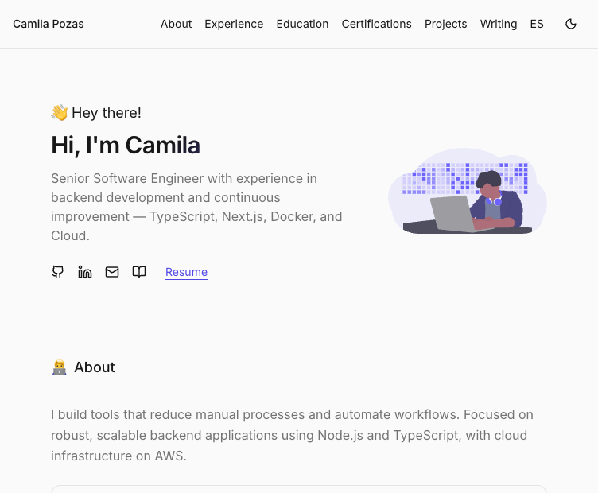

<div align="center">

# ✨ [camipg.com](https://www.camipg.com)

**Minimalist personal portfolio — monochrome, typography-driven, fast. In English and Spanish.**

[](https://nextjs.org/)
[](https://tailwindcss.com/)
[](https://typescriptlang.org/)
[](https://pnpm.io/)
[](https://vercel.com/)

<br />

<picture>
  <source media="(prefers-color-scheme: dark)" srcset=".github/assets/screenshot-dark.png" />
  
</picture>

> _Inspired by [leerob.io](https://leerob.io) and [rauno.me](https://rauno.me)_

</div>

---

## 🏗️ Stack

| Layer              | Tech                                                                              |
| ------------------ | --------------------------------------------------------------------------------- |
| ⚡ Framework       | [Next.js 16](https://nextjs.org/) (App Router, RSC)                               |
| 🎨 Styling         | [Tailwind CSS v4](https://tailwindcss.com/) + CSS custom properties               |
| 🧩 Components      | [shadcn/ui](https://ui.shadcn.com/) (button, card, separator, badge)              |
| 🌗 Theme           | [next-themes](https://github.com/pacocoursey/next-themes) (light / dark)          |
| 🌐 Languages       | English (`/`) and Spanish (`/es`), no i18n library — see [Languages](#-languages) |
| 🔤 Icons           | [lucide-react](https://lucide.dev/)                                               |
| 📦 Package Manager | [pnpm](https://pnpm.io/)                                                          |

## 🎨 Design

- **Near-monochrome palette** — black, white, one neutral gray. No accent colors.
- **Typography-driven** — clean type hierarchy, generous whitespace, narrow content column (672px).
- **No decorations** — no colored badges, no gradients, no shadows, no background patterns.
- **Dark mode** — seamless toggle, respects system preference.
- **Two languages** — `EN` / `ES` toggle next to the theme toggle; both choices are remembered on their own.

## 🌐 Languages

English is the default and lives at `/`; Spanish lives at `/es`. Both pages are prerendered at build time.

- **Content** — `lib/data.ts` holds every text in English. `lib/content.ts` (`getContent(lang)`) picks the strings that get translated; names, companies, schools, certification and post titles stay in English.
- **Translations** — `lib/translations/es.json` maps each English string to its Spanish version. Keying by the English text means adding or reordering entries in `data.ts` never puts a translation on the wrong item. A missing translation shows the English text.
- **First translation** — done with Claude Haiku, then reviewed by hand. The file is plain JSON: edit it directly.
- **Remembering the choice** — the toggle links to `?lang=es` or `?lang=en`. `proxy.ts` saves it in a `lang` cookie (one year) and redirects, so the language survives reloads the same way `next-themes` keeps the theme in `localStorage`. With no cookie, `/` serves English; a shared `/es` link always opens in Spanish.

**Adding or changing text:** edit `lib/data.ts`, run `pnpm test`, and add what the `i18n` test lists to `es.json` (it also lists stale keys to delete).

## 🚀 Getting Started

```bash
# Clone
git clone https://github.com/camipozas/portfolio.git
cd portfolio

# Install
pnpm install

# Run
pnpm dev

# Check
pnpm lint && pnpm test
```

Open [http://localhost:3000](http://localhost:3000) 🎉

## 🔧 Environment Variables

Create a `.env.local` file in the root:

```env
GITHUB_TOKEN=ghp_your_token_here
```

| Variable       | Required | Description                                         |
| -------------- | -------- | --------------------------------------------------- |
| `GITHUB_TOKEN` | No       | GitHub PAT — used to fetch pinned repos via GraphQL |

> 💡 Without the token, the Projects section shows a fallback link to GitHub.

## 📁 Project Structure

```
portfolio/
├── 📂 app/
│   ├── 📂 [lang]/        # en | es, prerendered
│   │   ├── layout.tsx    # Root layout (Inter font, ThemeProvider, localized metadata)
│   │   ├── page.tsx      # Home page (all sections)
│   │   └── globals.css   # Tailwind + monochrome CSS vars
│   ├── robots.ts
│   └── sitemap.ts        # Both languages, with hreflang alternates
├── 📂 components/
│   ├── 📂 ui/            # shadcn/ui primitives
│   ├── nav.tsx           # Sticky nav + language and theme toggles
│   ├── hero.tsx          # Name, subtitle, social links
│   ├── about.tsx         # Bio + skill badges
│   ├── experience.tsx    # Work timeline
│   ├── education.tsx     # Education timeline
│   ├── certifications.tsx # AWS certs with Credly links
│   ├── projects.tsx      # GitHub pinned repos (server component)
│   ├── writing.tsx       # Blog posts
│   └── footer.tsx        # Contact + socials
├── 📂 lib/
│   ├── types.ts          # TypeScript interfaces
│   ├── data.ts           # All portfolio content (English)
│   ├── content.ts        # getContent(lang): content in one language
│   ├── locale.ts         # Locales, cookie name, localizedPath()
│   ├── 📂 translations/
│   │   └── es.json       # English text → Spanish text
│   └── github.ts         # GitHub GraphQL (ISR 1h)
├── 📂 infra/             # Terraform for the assets CDN and photo backup (see infra/README.md)
├── proxy.ts              # Language routing + the `lang` cookie
└── package.json
```

## 📬 Contact

[](https://www.linkedin.com/in/camila-pozas-garcia/)
[](https://medium.com/@camipg)
[](mailto:cpozasg1103@gmail.com)

---

<div align="center">

Made with 🖤 by [Camila Pozas](https://github.com/camipozas)

</div>
